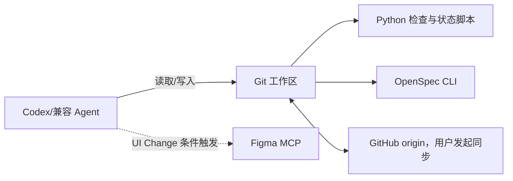

# 容器与部署

- Change ID：N/A（项目级架构基线）
- 状态：FROZEN（用户于 2026-11-17 批准）
- 来源基线：已评审产品流程、`docs/project/toolchain-report.md`、用户 2026-11-17 技术确认
- 关联需求/AC：RA-001、NFR-001、FLOW-001、BR-001/003/005/006
- 生成日期/版本：2026-11-17 / v0.2.0-draft

## 1. 环境

- 开发/执行：用户本地工作站 + Codex/兼容 Agent；Windows 仓库环境；Python 3.11.3、Git Bash、Node.js 22.14.0/OpenSpec CLI 1.14.3（见工具链报告）。
- 自动化服务/生产环境：N/A，本工具包无常驻业务服务。
- CI：N/A，当前仓库无 CI 配置；是否增加须另行评审。

## 2. 容器拓扑

应用容器、服务端进程、数据库、消息中间件和前端构建产物均 N/A（项目范围是研发工具包）。

## 3. 服务与端口

无监听服务和固定网络端口。CLI 以本地进程运行并通过标准输入/输出和退出码通信。

## 4. 服务路由

N/A；脚本按仓库相对路径调用，不提供网络路由。

## 5. 配置与密钥

- 非敏感工作流配置保存在版本化文档/JSON；运行时凭证由宿主 Git、Figma 或 Agent 环境管理。
- 不得将 token、密码、个人访问链接或用户隐私复制进仓库、日志或模型提示。

## 6. 网络入口、超时与重试

核心本地工作流不要求网络。GitHub 同步、公开资料查询及 Figma MCP 属条件性外连；凭据/网络失败时停止对应动作并记录阻塞，不改用未批准端点。不存在自动业务重试。

## 7. 容量假设

仓库和单次执行规模由 Change 范围决定；默认 AI 上下文最多 8 个读取组、目标 12,000 字符（NFR-001）。无服务容量/SLA 指标。

## 8. 发布、回滚与迁移

无服务部署。文档/脚本更改通过 Git diff 审查与用户决定的版本提交交付；状态迁移有工作流命令，不通过回滚文件伪造历史。

## 9. 备份与恢复

远端 Git 仓库是版本备份之一；审批证据和未提交变更仍需按本地工作区管理。恢复以可验证 Git 修订和工作流证据为准。

## 10. 可观测性与运维

脚本向 stdout/stderr 输出结果及退出码；正式门禁将输出保存到 `workflow/evidence/logs/`。不采集运行期遥测。

## 11. 安全基线

不输出凭据；校验正式写入路径处于仓库内；工作流状态使用原子写入/互斥锁；外部内容按不可信输入处理；用户审批、基线门禁和独立验证不可由快速路径跳过。
