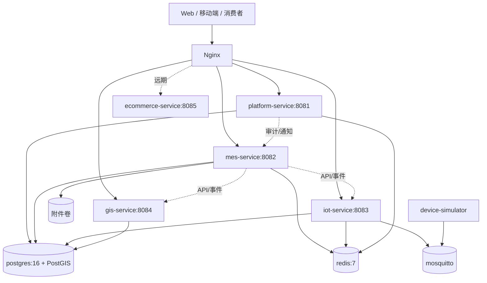

# 容器与部署

- Change ID：N/A（项目级架构基线）
- 状态：DRAFT v1.0（2026-11-10 服务化架构修订；待基线审批）
- 来源基线：技术选型访谈（2026-11-10）、NFR-001~004、用户 2026-11-10 架构指令
- 关联需求/AC：FLOW-001~008、BR-003/BR-005/BR-006
- 生成日期/版本：2026-11-10 / v1.0.0

## 1. 环境

| 环境 | 用途 | 运行方式 | 数据 | 备注 |
|---|---|---|---|---|
| 本地开发 | 开发与联调 | Docker Compose | 本地种子数据 | 模拟设备默认启用；电商 profile 关闭 |
| 测试/CI | 自动化测试 | Testcontainers + GitHub Actions | 临时数据库 | 每次流水线销毁 |
| 预发 | 验收前演示 | 单台云服务器 Docker Compose | 脱敏演示数据 | 与生产同镜像；电商关闭 |
| 生产 | 一期正式运行 | 单台云服务器 Docker Compose | 生产数据 | 每日备份，保留 30 天；电商关闭 |

## 2. 容器拓扑

- 共享 PostgreSQL 实例按服务划分 schema：`platform`、`mes`、`iot`、`gis`；`ecommerce` 仅在远期启用时创建。
- `ecommerce-service` 使用 Docker Compose profile `ecommerce`，默认不启动；Nginx 对 `/api/v1/ecommerce/**` 返回 404/503。
- `mosquitto` 与 `device-simulator` 为可选 profile，默认仅本地开发与演示启用。
- 附件一期写入 Docker 卷 `attachments`，由 `mes-service` 管理；接口层保留 S3/MinIO 适配。

## 3. 服务与端口

| 服务 | 镜像/构建 | 端口 | 卷 | 副本 | 说明 |
|---|---|---|---|---|---|
| `nginx` | nginx:stable-alpine | 80/443 | 静态资源、证书 | 1 | TLS、静态资源、服务路由、限流 |
| `platform-service` | 本地构建 | 8081（仅内网） | 无 | 1 | 身份、RBAC、审计、通知、系统配置 |
| `mes-service` | 本地构建 | 8082（仅内网） | 附件卷 | 1 | 农业 MES 主服务 |
| `iot-service` | 本地构建 | 8083（仅内网） | 无 | 1 | 设备、遥测、预警、控制 |
| `gis-service` | 本地构建 | 8084（仅内网） | 无 | 1 | 地块几何、图层、空间查询 |
| `ecommerce-service` | 本地构建（未来） | 8085（仅内网） | 未来卷 | 0/1 | 远期电商，默认关闭 |
| `postgres` | postgis/postgis:16-3.4 | 5432（仅内网） | `pgdata` | 1 | PostgreSQL 16 + PostGIS 3；schema 隔离 |
| `redis` | redis:7-alpine | 6379（仅内网） | `redisdata` | 1 | 缓存、限流计数、最新遥测 |
| `mosquitto` | eclipse-mosquitto:2 | 1883（仅内网） | `mosquitto` | 0/1 | 可选 MQTT，模拟或真实设备 |
| `device-simulator` | 本地构建或脚本 | 无 | 无 | 0/1 | 可选，模拟传感器与控制回执 |

## 4. 服务路由

| 外部路径 | 目标服务 | 鉴权 | 说明 |
|---|---|---|---|
| `/api/v1/platform/**` | platform-service | 用户 JWT / 登录匿名 | 登录、用户、角色、审计、通知、配置 |
| `/api/v1/mes/**` | mes-service | 用户 JWT | 计划、任务、作业、库存、批次、溯源、监管 |
| `/api/v1/iot/**` | iot-service | 用户 JWT / 设备适配内部令牌 | 设备、遥测、预警、控制 |
| `/api/v1/gis/**` | gis-service | 用户 JWT / 匿名只读图层例外 | 地块几何、图层、GeoJSON |
| `/api/v1/ecommerce/**` | ecommerce-service | 远期 | 默认 404/503；启用前需产品基线修订 |
| `/`、`/assets/**` | 静态资源 | 无 | Web 管理后台与 H5 资源 |

## 5. 配置与密钥

- 配置通过环境变量注入；`.env` 不提交仓库，提供 `.env.example`。
- 每个服务独立配置：`SPRING_PROFILES_ACTIVE`、`DB_URL`、`DB_SCHEMA`、`DB_USER`、`DB_PASSWORD`、`REDIS_HOST`、`JWT_PUBLIC_KEY`、`SERVICE_TOKEN`、`ATTACHMENT_DIR`、`TZ=UTC`。
- 只有 `platform-service` 持有 JWT 私钥；其他服务只持公钥并本地校验。服务间调用使用服务令牌，禁止共享用户令牌。
- 数据库按 schema 分账号：`platform_app`、`mes_app`、`iot_app`、`gis_app`；每个账号只读写本 schema。
- CORS 只允许配置的前端域名；消费者扫码页、Web 管理后台、GIS 图层接口分别配置。
- 生产关闭详细错误堆栈；只返回错误码与 `traceId`。

## 6. 网络入口、超时与重试

- Nginx 仅暴露 80/443；80 重定向到 443；启用 HSTS、安全响应头、请求体大小限制（附件上限 20MB）。
- 各服务只监听容器内网端口；PostgreSQL、Redis、MQTT 不暴露公网。
- 客户端默认超时 10 秒；GET 可安全重试 1 次；POST/PUT/PATCH/DELETE 不自动重试，必须使用 `Idempotency-Key`。
- 服务间调用超时 5 秒；设备控制指令超时 15 秒；失败记录并通知人工处理。
- GIS 图层查询超时 10 秒；大范围图层查询限制返回要素数量与精度。

## 7. 容量假设

| 指标 | 一期目标 | 设计响应 |
|---|---|---|
| 并发用户 | <100 | 4 vCPU / 16GB RAM / 200GB SSD 单机 |
| 服务 JVM 堆 | platform 1GB、mes 2GB、iot 1GB、gis 1GB | 预留 OS/PostgreSQL/Redis/附件空间 |
| 环境数据上报 | 每设备每分钟 1 次，预计 <200 设备 | IoT 批量写入 + 异步预警评估 |
| GIS 图层 | 地块 <5000，单次返回要素 <2000 | 空间索引 + 简化几何 + 分页/范围过滤 |
| 附件 | 单文件 <20MB，日增 <2GB | 本地卷 + 每日备份，后续 S3 适配 |
| 数据库连接池 | 每服务 10，总 <40 | HikariCP；按 CPU 与查询耗时调整 |
| Redis 内存 | 512MB | 仅缓存、限流计数、最新遥测；设置淘汰策略 |

## 8. 发布、回滚与迁移

1. CI 为每个服务构建镜像并打不可变 tag（git SHA）。
2. 预发环境先执行 `docker compose pull && docker compose up -d`，跑跨服务冒烟测试。
3. 生产发布顺序：数据库迁移（Flyway expand）→ 依赖方服务 → 被依赖服务 → Nginx 路由确认。
4. 迁移采用 expand/contract：先加兼容列/表，再切代码，最后清理旧结构；禁止破坏性迁移与代码同批上线。
5. 每个服务只执行本 schema 的迁移；跨 schema 变更必须拆分为兼容步骤。
6. 回滚：应用镜像回退到上一 tag；数据库迁移只前进不回滚，必须保证旧版本代码兼容新结构。
7. `ecommerce-service` 不参与一期发布；启用时必须单独审批并新增产品基线、数据库 schema 与迁移。

## 9. 备份与恢复

- PostgreSQL 每日 `pg_dump` 全量备份，保留 30 天；每周一次恢复演练。
- Redis 仅缓存，不作为唯一数据源；丢失可重建。
- 附件卷每日增量备份；与数据库备份同批次校验。
- GIS 几何随 PostgreSQL 备份；底图服务不备份。
- 审计日志与业务数据同库备份，保留 2 年；到期归档需记录审批。

## 10. 可观测性与运维

- 各服务输出 JSON 结构化日志到 stdout，Docker 日志轮转（单文件 100MB，保留 5 个）。
- 每个服务暴露 `/actuator/health` 与 `/actuator/info`，仅内网可访问；Nginx 健康检查。
- 每个请求生成 `traceId`，贯穿 Nginx、各服务、数据库慢查询日志与审计日志；服务间透传 `X-Trace-Id`。
- 一期以日志与 Actuator 为主；Prometheus/Grafana 作为后续可选增强。
- 关键告警：任一服务不可用、数据库连接耗尽、IoT 离线率异常、GIS 图层超时、审计写入失败。
- 服务启动顺序：PostgreSQL/Redis → platform-service → mes/iot/gis → Nginx；使用 healthcheck 与 depends_on。

## 11. 安全基线

- 生产使用 HTTPS；证书自动续期或人工更新有记录。
- 数据库按 schema 最小权限；迁移账号单独管理。
- 服务间使用服务令牌，外部请求使用用户 JWT；禁止服务间信任未认证请求。
- 依赖漏洞扫描在 CI 执行（Trivy 或 OWASP Dependency-Check）；高危阻断合并。
- 日志脱敏：不记录密码、JWT、完整手机号、身份证号、附件内容与 GIS 坐标明细。
- 电商服务启用前必须单独做支付安全、PCI/合规与隐私评估。
