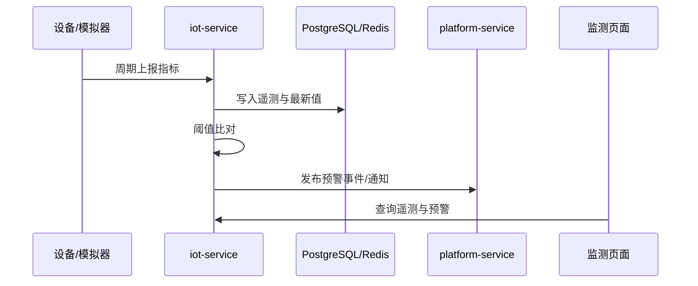
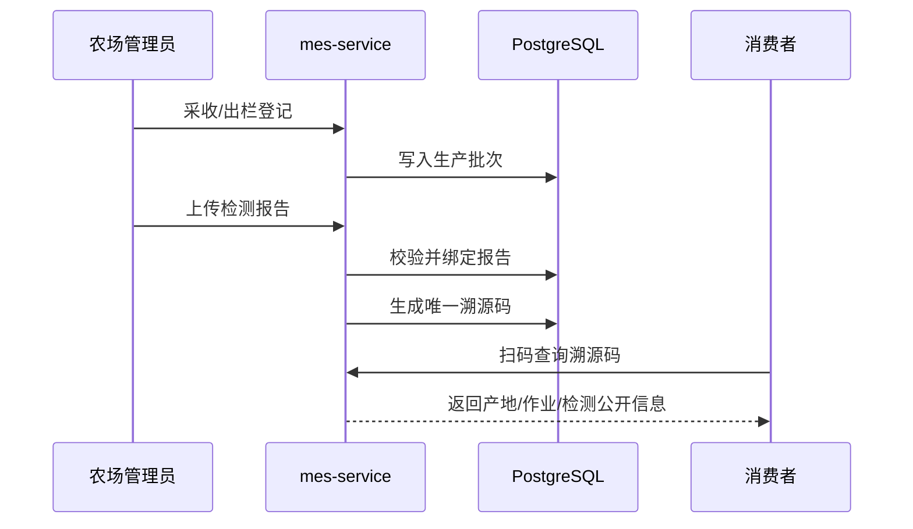
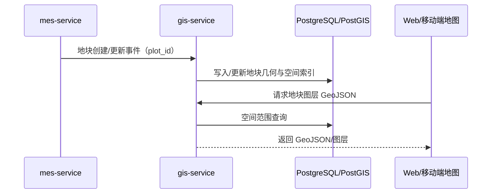

# 数据流

- Change ID：N/A（项目级架构基线）
- 状态：DRAFT v1.0（2026-11-10 服务化架构修订；待基线审批）
- 来源基线：产品基线 v0.6-DRAFT、技术选型访谈（2026-11-10）、用户 2026-11-10 架构指令
- 关联需求/AC：FLOW-001~008、NODE-001-01~NODE-008-12、DO-001~028
- 生成日期/版本：2026-11-10 / v1.0.0

## 1. 数据流总览

| DF ID | 数据流 | 触发 | 同步/异步 | 主要服务/领域 | 关联 FLOW/NODE | 关键 DO/实体 |
|---|---|---|---|---|---|---|
| DF-001 | 环境数据采集与预警 | 设备周期上报 | 同步采集 + 异步预警 | `iot-service`、`platform-service` | FLOW-001、NODE-001-01~09 | DO-010、DO-011、DO-012、DO-013、DO-026 |
| DF-002 | 生产计划与任务派发 | 管理员制定计划 | 同步 | `mes-service` | FLOW-004、NODE-004-01~12 | DO-003、DO-004、DO-005、DO-019、DO-026 |
| DF-003 | 任务执行与农资消耗 | 作业人员提交记录 | 同步 | `mes-service` | FLOW-002、FLOW-004、NODE-002-01~10、NODE-004-05 | DO-005、DO-006、DO-007、DO-008、DO-009 |
| DF-004 | 农资入库与出库 | 采购入库或任务领用 | 同步 | `mes-service` | FLOW-006、NODE-006-01~09 | DO-007、DO-008、DO-009、DO-025 |
| DF-005 | 批次形成与溯源查询 | 采收/出栏或消费者扫码 | 同步 | `mes-service` | FLOW-003、NODE-003-01~10 | DO-015、DO-016、DO-017、DO-018 |
| DF-006 | 设备远程控制 | 管理员下发指令 | 同步下发 + 异步回执 | `iot-service`、`platform-service` | FLOW-005、NODE-005-01~08 | DO-010、DO-014、DO-021 |
| DF-007 | 监管汇总与下钻 | 定时汇总或监管查询 | 定时批处理 + 同步查询 | `mes-service` | FLOW-007、NODE-007-01~08 | DO-022、DO-023、DO-027、DO-001、DO-011、DO-005、DO-015 |
| DF-008 | 登录认证与权限校验 | 用户登录或请求受保护资源 | 同步 | `platform-service`、各服务 | FLOW-008、NODE-008-03~04 | DO-019、DO-020、DO-021 |
| DF-009 | 审计日志写入 | 关键操作或越权事件 | 异步追加 | `platform-service`、全部服务 | FLOW-008、NODE-008-05；各领域异常节点 | DO-021 |
| DF-010 | 附件上传与读取 | 作业照片或检测报告上传 | 同步 | `mes-service` | FLOW-002、FLOW-003、NODE-002-02、NODE-003-03 | DO-006、DO-016 |
| DF-011 | GIS 地块几何与图层查询 | MES 地块变更或前端地图请求 | 事件同步 + 查询同步 | `gis-service`、`mes-service` | FLOW-004、NODE-004-01；FLOW-001、NODE-001-05 | DO-001、ENT-029 |
| DF-012 | 电商远期只读数据流 | 远期商品/订单查询 | 远期 | `ecommerce-service`、`mes-service` | FLOW-003、NODE-003-09 | DO-015、DO-016、DO-017（只读） |

## 2. 关键数据流

### DF-001：环境数据采集与预警

- 关联 FLOW/NODE/DO/RD：FLOW-001、NODE-001-01~09、DO-010/011/012/013/026；RD 行见 `rd-matrix.csv` 中对应 node_id。
- 数据分类：农场与地块运营数据；不含个人敏感信息。
- 同步/异步边界：遥测入库同步；预警通知异步。
- 超时、重试、幂等：设备上报 10 秒超时；同一设备同一采集时间重复上报按幂等覆盖；非法数据拒绝入库。
- 事务/补偿/一致性：单条遥测入库为本地事务；预警事件通过 Outbox 投递，失败重试。
- 失败与告警：设备离线标记并通知；连续非法数据通知设备维护人；预警通知失败进入重试队列。

### DF-002：生产计划与任务派发

- 关联 FLOW/NODE/DO/RD：FLOW-004、NODE-004-01~12、DO-003/004/005/019/026。
- 数据分类：生产计划与任务，内部管理数据；责任人信息最小化。
- 同步/异步边界：计划与模板生成任务同步；派发通知异步。
- 超时、重试、幂等：计划创建幂等键；重复派发不重复生成任务；模板缺失时转临时任务。
- 事务/补偿/一致性：计划与任务在 `mes-service` 同一领域事务内生成；用户查询调用 platform-service；通知失败不回滚任务。
- 失败与告警：计划冲突提示调整；模板缺失提示创建模板；逾期任务提醒并升级。

### DF-003：任务执行与农资消耗

- 关联 FLOW/NODE/DO/RD：FLOW-002、FLOW-004、NODE-002-01~10、NODE-004-05、DO-005/006/007/008/009。
- 数据分类：作业记录含照片与用量，内部数据；照片可能含人员影像，按最小化与访问控制处理。
- 同步/异步边界：作业记录保存与库存扣减同步；任务提交待审核同步；审核通知异步。
- 超时、重试、幂等：提交使用 `Idempotency-Key`；重复提交返回首次结果；库存扣减在同一 `mes-service` 事务内。
- 事务/补偿/一致性：作业记录保存与库存扣减分属 DOM-004 与 DOM-005，通过 `mes-service` 内部应用服务调用；失败时记录不标记完成。
- 失败与告警：库存不足返回 409 并提示补货；必填缺失保留草稿；越权拒绝并审计。

### DF-004：农资入库与出库

- 关联 FLOW/NODE/DO/RD：FLOW-006、NODE-006-01~09、DO-007/008/009/025。
- 数据分类：采购与库存数据，内部经营数据；供应商联系方式按个人信息/商业信息保护。
- 同步/异步边界：入库、出库、盘点同步；安全库存预警异步。
- 超时、重试、幂等：出入库单使用 `Idempotency-Key`；重复提交不重复扣减。
- 事务/补偿/一致性：单据与库存余额在同一 `mes-service` 领域事务内更新；验收不合格不进入可用库存。
- 失败与告警：库存不足拦截；验收不合格退回；库存差异记录调整原因。

### DF-005：批次形成与溯源查询

- 关联 FLOW/NODE/DO/RD：FLOW-003、NODE-003-01~10、DO-015/016/017/018。
- 数据分类：批次与检测信息，部分公开；消费者可见字段白名单；检测报告附件受控。
- 同步/异步边界：批次、报告、码生成同步；扫码查询同步只读。
- 超时、重试、幂等：溯源码生成幂等且唯一；重复码拒绝；扫码查询可缓存短 TTL。
- 事务/补偿/一致性：批次与报告绑定在同一领域事务；报告缺失时拒绝生成码；码生成后不可重复。
- 失败与告警：重复码记录冲突；扫码数据缺失展示可见部分并标注；报告缺失拦截并通知。

### DF-006：设备远程控制

- 关联 FLOW/NODE/DO/RD：FLOW-005、NODE-005-01~08、DO-010/014/021。
- 数据分类：设备控制指令，内部运营数据；操作人信息按个人信息保护。
- 同步/异步边界：权限校验与指令记录同步；设备回执异步；超时后标记失败。
- 超时、重试、幂等：指令使用 `Idempotency-Key`；非幂等指令不自动重试；超时 15 秒。
- 事务/补偿/一致性：`iot-service` 记录指令与审计；执行结果回写；失败通知人工。
- 失败与告警：设备离线提示；越权拒绝并审计；执行失败通知管理员。

### DF-007：监管汇总与下钻

- 关联 FLOW/NODE/DO/RD：FLOW-007、NODE-007-01~08、DO-022/023/027/001/011/005/015。
- 数据分类：辖区汇总，监管共享数据；个人与农场敏感信息脱敏或聚合。
- 同步/异步边界：汇总定时批处理；看板与下钻同步只读。
- 超时、重试、幂等：汇总按周期幂等重算；导出记录操作人与时间。
- 事务/补偿/一致性：汇总表按周期覆盖写入；IoT 遥测通过 `iot-service` API/事件获取；数据缺失标注，不默认为零。
- 失败与告警：越权拒绝并审计；汇总缺失通知农场补录；导出无数据提示。

### DF-008：登录认证与权限校验

- 关联 FLOW/NODE/DO/RD：FLOW-008、NODE-008-03~04、DO-019/020/021。
- 数据分类：账号与认证信息，个人敏感信息；密码只存哈希，JWT 不落库。
- 同步/异步边界：登录与权限校验同步；失败审计异步或同步追加。
- 超时、重试、幂等：登录限流；失败次数锁定；JWT 无状态。
- 事务/补偿/一致性：`platform-service` 签发 JWT；其他服务用公钥本地校验并强制角色/数据范围；权限变更后旧令牌在过期前仍有效，敏感操作二次校验。
- 失败与告警：认证失败 401；越权 403 并审计；账号停用拒绝登录。

### DF-009：审计日志写入

- 关联 FLOW/NODE/DO/RD：FLOW-008、NODE-008-05、各领域异常节点、DO-021。
- 数据分类：审计数据，含操作人与对象；保留 2 年，不物理删除。
- 同步/异步边界：关键安全事件同步追加；普通业务事件异步追加。
- 超时、重试、幂等：审计写入失败不得静默；本地缓冲 + 重试；审计失败告警。
- 事务/补偿/一致性：审计与业务操作同事务或 Outbox；不可删除。
- 失败与告警：写入失败阻断敏感操作；审计查询只读。

### DF-010：附件上传与读取

- 关联 FLOW/NODE/DO/RD：FLOW-002、FLOW-003、NODE-002-02、NODE-003-03、DO-006/016。
- 数据分类：作业照片与检测报告，可能含个人信息与商业信息；按对象访问控制。
- 同步/异步边界：上传同步；病毒扫描可异步；读取按权限签名。
- 超时、重试、幂等：上传使用内容哈希去重；大文件分片可选；失败重试。
- 事务/补偿/一致性：附件元数据与业务记录同事务；文件写入失败回滚元数据。
- 失败与告警：超限拒绝；类型不符拒绝；读取越权拒绝并审计。

### DF-011：GIS 地块几何与图层查询

- 关联 FLOW/NODE/DO/RD：FLOW-004、NODE-004-01（地块主数据）；FLOW-001、NODE-001-05（地图展示）；DO-001（业务地块）、ENT-029（地块几何）。
- 数据分类：地块空间数据，内部运营数据；GIS 坐标明细不写普通日志。
- 同步/异步边界：地块主数据变更事件异步同步到 GIS；图层查询同步。
- 超时、重试、幂等：事件按 `plot_id + version` 幂等更新；图层查询 10 秒超时；大范围查询限制要素数量。
- 事务/补偿/一致性：GIS 几何写入为本地事务；MES 业务事务不依赖 GIS 成功；地块删除/停用通过事件同步。
- 失败与告警：GIS 不可用时地图层降级为空态并提示；MES 核心业务不受影响；几何缺失标注而不是伪造。
- 未决约束：真实测绘坐标、坐标系统与底图来源仍由 Q-014 决定；一期支持手工绘制/导入 GeoJSON。

### DF-012：电商远期只读数据流

- 关联 FLOW/NODE/DO/RD：FLOW-003、NODE-003-09（消费者扫码查询）；DO-015/016/017（只读）。
- 数据分类：未来商品与订单数据，涉及个人信息与支付信息；需单独合规评估。
- 同步/异步边界：一期不运行；远期通过 MES 溯源只读 API 获取批次公开信息。
- 超时、重试、幂等：远期定义；订单与支付必须幂等。
- 事务/补偿/一致性：电商拥有自己的 schema 与事务；不得写 MES 主数据。
- 失败与告警：一期 Nginx 返回 404/503；远期启用前必须完成产品基线修订（Q-004 范围重评）与安全评估。

## 3. 数据分类与敏感字段

| 分类 | 示例 | 存储/传输 | 访问控制 | 保留 |
|---|---|---|---|---|
| 公开溯源数据 | 批次号、产地、检测结果摘要 | 消费者查询接口 | 匿名只读，字段白名单 | 2 年 |
| 内部业务数据 | 计划、任务、作业记录、库存 | PostgreSQL `mes` schema | 角色 + 数据范围 | 2 年 |
| 个人数据 | 姓名、账号、手机号、照片 | PostgreSQL/附件 | 最小化、脱敏日志、权限控制 | 2 年或按合规要求 |
| 安全审计数据 | 登录、越权、控制指令 | PostgreSQL `platform` schema | 系统管理员只读 | 2 年 |
| 设备数据 | 设备地址、读数、指令 | PostgreSQL `iot` schema/Redis | 农场范围 | 2 年 |
| 空间数据 | 地块边界、图层、坐标 | PostgreSQL `gis` schema/PostGIS | 农场范围；公开图层白名单 | 2 年 |
| 电商数据（远期） | 商品、订单、支付、售后 | 未来 `ecommerce` schema | 单独评估 | 未来定义 |

## 4. 一致性检查

- 每条 DF 均引用至少一个 FLOW/NODE 与相关 DO/实体；RD 行通过 node_id 在 `rd-matrix.csv` 中定位。
- 所有跨服务写入均通过 API 或 Outbox，不直接跨服务写 schema。
- DF-001/005/006/011 的失败分支与 FLOW-001/003/005 的异常节点一致。
- `ecommerce-service` 数据流为远期，不参与一期实现与验收。
