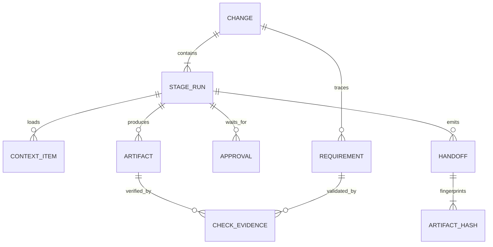

# 逻辑 ERD

- Change ID：N/A（项目级架构基线）
- 状态：FROZEN（用户于 2026-11-17 批准）
- 来源基线：`docs/product/data-objects.csv`、`rd-matrix.csv`、`workflows.md`
- 关联需求/AC：RA-001、FLOW-001、DO-001–005、RD-001–009
- 生成日期/版本：2026-11-17 / v0.2.0-draft

## 1. 逻辑实体关系

该图描述工作流元数据关系，不代表当前存在关系数据库或物理表。

## 2. 实体目录

| 实体 ID | 实体 | 关联 DO ID | 所有者领域 | 关系/不变量 |
|---|---|---|---|---|
| ENT-001 | Change | DO-001/003/005 | DOM-001/003 | 一个 Change 划定验收范围和基线绑定 |
| ENT-002 | StageRun | DO-002–005 | DOM-001–003 | 具有单一当前阶段；只按 DAG 迁移 |
| ENT-003 | ContextItem | DO-002 | DOM-001 | 每项有路径、触发理由和预算归属 |
| ENT-004 | Artifact | DO-003/004 | DOM-002 | 一个权威路径；输出可被检查和哈希 |
| ENT-005 | Requirement | DO-001/003 | DOM-001/002 | 通过稳定 ID 映射到流程节点和验收依据 |
| ENT-006 | CheckEvidence | DO-004 | DOM-002 | 记录真实命令、退出码、修订和结果 |
| ENT-007 | Approval | DO-005 | DOM-003 | 关联阶段/Change、批准人、日期和证据 |
| ENT-008 | HandoffManifest | DO-005 | DOM-003 | 单一上游/下游边；含输入/产物指纹 |
| ENT-009 | ArtifactHash | DO-005 | DOM-003 | SHA-256 对应一份交接产物修订 |

DO-001–005 全部映射到上述实体；验证实体化的业务数据对象不扩展农业领域模型。

## 3. 关系与不变量

- Change 1:N StageRun；StageRun 1:N ContextItem/Artifact/CheckEvidence/Approval/Handoff。
- Artifact 1:N CheckEvidence；Requirement 1:N CheckEvidence；Handoff 1:N ArtifactHash。
- 每个批准必须针对明确评审目标；每次迁移至少有审查证据和满足条件的输入修订。

## 4. 标识、时间与并发约定

概念 ID 遵循 `docs/product/id-conventions.md`；状态更新时间使用 UTC ISO-8601；每份证据保存所检查修订。当前 JSON/CSV/Markdown 文件无数据库级并发/事务控制，只有状态机文件使用互斥锁与原子替换。

## 5. GIS 与未来服务实体

N/A：本系统为 AI coding 流程工具包，无农业地理信息、订单、农场、设备或支付等运行期业务实体。未来农业应用需在其范围确定后新增 Change/领域基线。

## 6. 与物理模型的边界

N/A：当前没有物理数据库或 DDL；此逻辑图只用于说明流程记录关系。任何持久化数据库选型留给未来有需求的架构/Change 评审。
