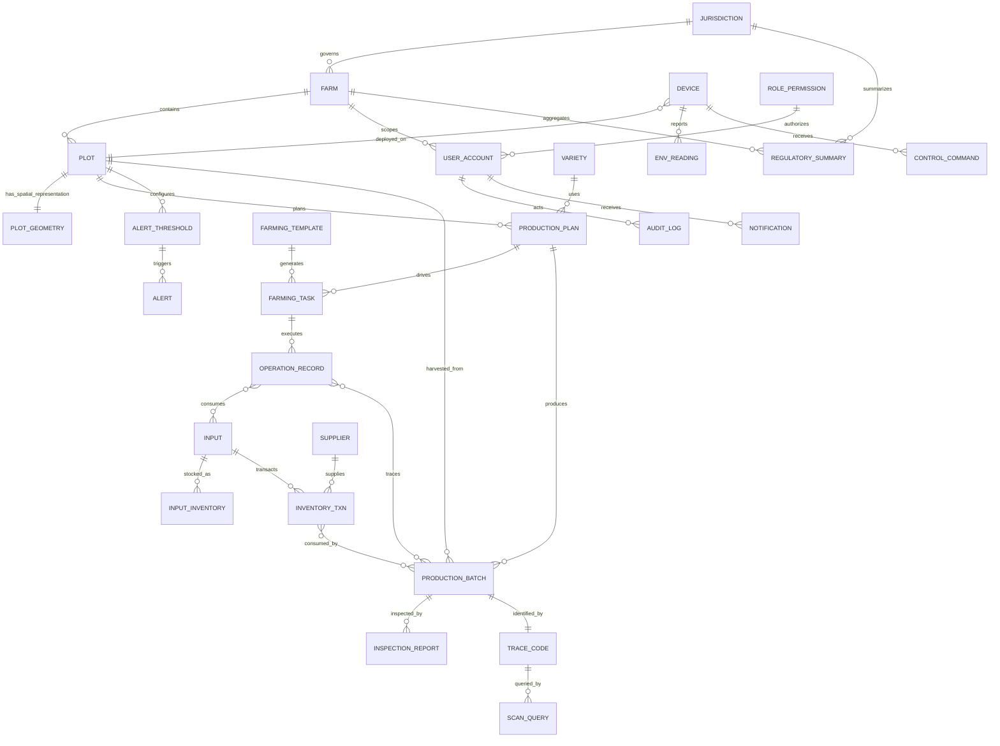

# 逻辑 ERD

- Change ID：N/A（项目级架构基线）
- 状态：DRAFT v1.0（2026-11-10 服务化架构修订；待基线审批）
- 来源基线：产品基线 v0.6-DRAFT、领域边界基线、用户 2026-11-10 架构指令
- 关联需求/AC：DO-001~028、ENT-029~033、FLOW-001~008
- 生成日期/版本：2026-11-10 / v1.0.0

## 1. 逻辑实体关系

> 说明：`SYSTEM_CONFIG`、`OPERATION_TYPE` 为独立配置/字典实体；`NOTIFICATION` 为平台支撑实体；`PLOT_GEOMETRY` 由 `gis-service` 拥有；电商实体为远期预留，不在本期 ERD 关系中。

## 2. 实体目录

| 实体 ID | 对应 DO ID | 业务含义 | 数据所有者/服务 | 关系/基数 | 生命周期 | 状态 |
|---|---|---|---|---|---|---|
| ENT-001 | DO-023 | 农场/园区 | `mes-service` | 辖区 1:N 农场；农场 1:N 地块 | 创建、启用、停用 | DRAFT |
| ENT-002 | DO-001 | 地块 | `mes-service` | 农场 1:N 地块；地块 1:N 计划/任务/批次 | 创建、启用、停用 | DRAFT |
| ENT-003 | DO-002 | 品种 | `mes-service` | 品种 1:N 计划 | 创建、修订、停用 | DRAFT |
| ENT-004 | DO-024 | 作业类型 | `mes-service` | 任务/记录引用 | 创建、修订、停用 | DRAFT |
| ENT-005 | DO-003 | 生产计划 | `mes-service` | 计划 1:N 任务；计划 1:N 批次 | 草稿、已批准、执行中、关闭 | DRAFT |
| ENT-006 | DO-004 | 农事模板 | `mes-service` | 模板 1:N 任务 | 草稿、已发布、停用 | DRAFT |
| ENT-007 | DO-005 | 农事任务 | `mes-service` | 任务 1:N 作业记录；任务 N:1 计划 | 待执行、待审核、已闭环、驳回、逾期 | DRAFT |
| ENT-008 | DO-006 | 作业记录 | `mes-service` | 记录 N:1 任务；记录 N:M 投入品/批次 | 草稿、已提交、已审核、补录 | DRAFT |
| ENT-009 | DO-007 | 农资 | `mes-service` | 农资 1:N 库存/出入库 | 启用、停用 | DRAFT |
| ENT-010 | DO-008 | 农资库存 | `mes-service` | 农资 1:N 库存批次 | 实时余额，盘点调整 | DRAFT |
| ENT-011 | DO-009 | 农资出入库单 | `mes-service` | 单据 N:1 农资/供应商；单据 N:M 任务/批次 | 草稿、已验收、已出库、退回、作废 | DRAFT |
| ENT-012 | DO-025 | 供应商 | `mes-service` | 供应商 1:N 入库单 | 启用、停用 | DRAFT |
| ENT-013 | DO-010 | 设备 | `iot-service` | 设备 N:1 地块；设备 1:N 读数/指令 | 注册、在线、离线、停用 | DRAFT |
| ENT-014 | DO-011 | 环境监测数据 | `iot-service` | 读数 N:1 设备/地块 | 写入、归档 | DRAFT |
| ENT-015 | DO-012 | 预警阈值 | `iot-service` | 阈值 N:1 地块；阈值 1:N 预警 | 草稿、生效、失效 | DRAFT |
| ENT-016 | DO-013 | 预警记录 | `iot-service` | 预警 N:1 阈值/地块 | 待处理、已处理、忽略 | DRAFT |
| ENT-017 | DO-014 | 设备控制指令 | `iot-service` | 指令 N:1 设备；指令 N:1 操作人 | 待下发、已下发、成功、失败 | DRAFT |
| ENT-018 | DO-015 | 生产批次 | `mes-service` | 批次 N:1 计划/地块；批次 1:N 报告；批次 1:1 码 | 形成、待检测、可溯源、作废 | DRAFT |
| ENT-019 | DO-016 | 检测报告 | `mes-service` | 报告 N:1 批次 | 已上传、已校验、失效 | DRAFT |
| ENT-020 | DO-017 | 溯源码 | `mes-service` | 码 1:1 批次；码 1:N 扫码记录 | 有效、作废 | DRAFT |
| ENT-021 | DO-018 | 扫码查询记录 | `mes-service` | 记录 N:1 溯源码 | 写入、归档 | DRAFT |
| ENT-022 | DO-019 | 用户 | `platform-service` | 用户 N:1 角色/数据范围；用户 1:N 审计/通知 | 启用、停用、锁定 | DRAFT |
| ENT-023 | DO-020 | 角色权限 | `platform-service` | 角色 1:N 用户；角色 N:M 能力 | 草稿、生效、停用 | DRAFT |
| ENT-024 | DO-021 | 审计日志 | `platform-service` | 日志 N:1 用户/对象 | 追加、归档 | DRAFT |
| ENT-025 | DO-022 | 监管汇总 | `mes-service` | 汇总 N:1 辖区/农场 | 按周期生成、覆盖、归档 | DRAFT |
| ENT-026 | DO-027 | 辖区 | `mes-service` | 辖区 1:N 农场/汇总 | 创建、调整、停用 | DRAFT |
| ENT-027 | DO-026 | 通知 | `platform-service` | 通知 N:1 用户/业务对象 | 待发送、已发送、已读、失败 | DRAFT |
| ENT-028 | DO-028 | 系统配置 | `platform-service` | 独立配置项 | 草稿、生效、失效 | DRAFT |
| ENT-029 | N/A（引用 DO-001） | 地块几何 | `gis-service` | 地块 1:1 几何；图层 1:N 几何 | 创建、修订、失效 | DRAFT |

## 3. 关系与不变量

- 生产批次是溯源核心聚合根，必须关联计划、地块、投入品、作业记录与检测报告；缺少任一关键关联时不得生成溯源码（BR-009、BR-002）。
- 溯源码与批次一对一，同一批次只能有一个有效码；码作废后可重新生成新码，但旧码保留历史（BR-001）。
- 库存余额由库存批次汇总；出入库单必须关联农资与经办人，出库必须关联任务或地块（BR-007）。
- 任务必须记录来源（计划/模板/临时）与责任人；作业记录必须回写任务（BR-008）。
- 角色权限与用户数据范围共同决定访问控制；监管用户只读且受辖区约束（BR-005）。
- 审计日志为追加型，不允许更新与删除（BR-003）。
- 地块业务主数据 DO-001 由 `mes-service` 拥有；地块几何 ENT-029 由 `gis-service` 拥有，以 `plot_id` 引用 DO-001；GIS 不得复制或改写业务地块字段。
- 设备、遥测、阈值、预警、控制指令由 `iot-service` 拥有；MES 只通过 API/事件消费。

## 4. 标识、时间与并发约定

- 技术主键：UUID v7；业务编码（批次号、溯源码、订单号）另行定义，不替代技术主键。
- 审计字段：`created_at`、`updated_at`、`created_by`、`updated_by`、`version`；审计日志额外 `trace_id`、`result`。
- 时间：UTC 存储；前端按用户时区展示；保留 2 年（BR-006）。
- 并发：乐观锁 `version`；唯一约束覆盖账号、溯源码、批次-码绑定、角色能力组合、设备编号、plot_id 几何。
- 删除：业务记录使用状态/作废标记，不物理删除；审计日志只追加。
- 枚举：数据库存储大写下划线常量；前端展示中文标签；禁止在库中存中文枚举值。
- schema：`platform`、`mes`、`iot`、`gis`；`ecommerce` 仅在未来启用时创建。

## 5. GIS 与未来服务实体

### 5.1 GIS 实体

| 实体 ID | 名称 | 所有者/服务 | 关键属性 | 关系 | 说明 |
|---|---|---|---|---|---|
| ENT-029 | 地块几何 | `gis-service` | plot_id、geometry（Polygon/MultiPolygon）、crs、area、version、updated_at | 地块 1:1 几何 | 以 `plot_id` 引用 DO-001；坐标系统由 Q-014 决定；一期支持手工绘制/导入 GeoJSON |

- GIS 几何使用 PostGIS `geometry` 类型与空间索引；不复制 DO-001 的业务字段。
- 地块创建/更新/停用由 MES 发布事件，GIS 幂等更新；MES 业务事务不依赖 GIS 成功。
- 公开图层字段白名单：plot_id、名称、几何、状态、当前品种；不得输出用户与经营敏感字段。

### 5.2 未来电商实体（DEFERRED）

| 未来实体 ID | 名称 | 所有者/服务 | 说明 |
|---|---|---|---|
| ENT-030 | 商品/供应信息 | `ecommerce-service`（远期） | 基于 MES 溯源与批次公开信息构建商品展示；一期不落库 |
| ENT-031 | 订单 | `ecommerce-service`（远期） | 下单、支付、履约状态；需幂等与支付安全评估 |
| ENT-032 | 支付记录 | `ecommerce-service`（远期） | 支付渠道、金额、状态；需合规与 PCI 评估 |
| ENT-033 | 售后记录 | `ecommerce-service`（远期） | 退换货、投诉与处理；需产品基线修订后定义 |

> 电商实体不在一期 ERD 关系中、不分配 DO、不创建 schema；启动前必须完成 Q-004 范围重评与产品基线修订。`ecommerce-service` 仅消费 MES 溯源只读数据，不写 MES 主数据。

## 6. 与物理模型的边界

- 本文件是逻辑模型基线，不定义表名、索引、分区、外键策略与字段类型细节。
- 阶段 07 的每个 Change 在本 Change 的 `design.md` 中给出物理表、迁移、索引与回滚方案，并引用本文件的 ENT/DO ID。
- 物理模型若需要改变实体关系、数据所有权或服务归属，必须发起基线修订，不得在 Change 中静默修改。
- `ecommerce-service` 的物理模型在远期产品基线修订后单独设计，不在本基线中预建表。
