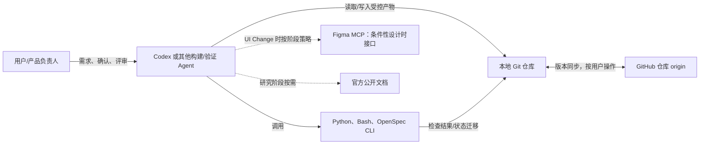

# 系统上下文与模块边界

- Change ID：N/A（项目级架构基线）
- 状态：FROZEN（v0.2.2；ARCH-STATUS-002 已批准）
- 来源基线：已评审的 `docs/product/requirements-analysis.md`、`workflows.md`、`rd-matrix.csv`、`business-rules.md`；用户于 2026-11-17 确认架构范围
- 关联需求/AC：RA-001、NFR-001、FLOW-001、NODE-001-01–09、DO-001–005、BR-001–007
- 生成日期/版本：2026-11-17 / v0.2.2

## 1. 系统定位

本系统是项目内的 AI coding 研发流程工具包：Markdown 规则、Skills/Prompts、Python 检查及状态机脚本、OpenSpec CLI 配置和工作流证据。此架构只覆盖该工具包，不覆盖尚不存在的农业业务应用。

## 2. 系统上下文

信任边界：用户负责目标与审批；Agent 只能在当前阶段授权范围内读写；确定性脚本校验状态和产物；远程 GitHub 是源代码托管边界；Figma MCP 和公开网站仅为条件性外部服务，不存放项目权威工作流状态。

## 3. 系统职责与非目标

### 3.1 系统职责

- 以阶段契约、条件化上下文、权威产物、检查和显式评审支撑可恢复交付（RA-001、BR-001–007）。
- `scripts/workflow.py` 管理阶段入口、审批、状态迁移和内容哈希交接；其他检查脚本负责确定性校验。
- 文档/索引记录业务与工程约束，OpenSpec 承载功能 Change。

### 3.2 明确非目标

- 不提供种植、畜牧、水产、监管等农业业务功能、网页、移动客户端、服务端或数据库。
- 不自行发布、部署、归档或批准；不绕过工作流审批。
- 不把 Figma、GitHub 或模型服务作为本地工作流数据的权威来源。

## 4. 服务边界与依赖

| 模块 | 职责 | 依赖方向 | 权威数据 |
|---|---|---|---|
| 流程定义 | `docs/`、`prompts/`、`.claude/skills/` 定义步骤和模板 | 被 Agent/脚本读取 | 各正式契约文件 |
| 工作流运行时 | `workflow.py`、`agent-context.py`、门禁脚本 | 读取契约并校验/更新状态 | `workflow-state.json`、handoff JSON |
| 变更规范 | OpenSpec CLI/config 和 `openspec/` | 使用批准基线定义功能变更 | OpenSpec Change 文件 |
| 证据与索引 | `workflow/evidence/`、生成索引 | 引用输入与命令日志 | 阶段 evidence、基线文件 |

边界间通过文件、明确 CLI 参数/退出码和路径引用协作；不依赖未声明的 Python 模块私有实现。

## 5. 信任区与边界

- 受控工作区：当前仓库文件；工作流工具只允许在仓库范围解析正式输出路径。
- 执行环境：Python、Git Bash、Node/OpenSpec CLI；版本和可用性按工具链报告确认。
- 外部服务：GitHub（远端源代码托管）、Figma MCP（UI 设计时条件依赖）、官方公开资料（研究时）。凭证不写入仓库或日志。
- 用户审批是越过阶段边界的唯一授权；模型输出和脚本 PASS 均不能代替批准。

## 6. 外部系统与 SLA

当前无农业应用运行期第三方 API、SLA 或业务数据共享。GitHub 为开发时远端版本托管；Figma MCP 仅在 UI Change 阶段依仓库规则使用；官方文档网站仅用于按需研究。相关边界、故障处理和数据限制见 `technology-decisions.md` 与 `data-flows.md`。

## 7. 关键非功能约束

- 默认上下文最多 8 组、目标 12,000 字符；按需资料按触发标签加载（NFR-001/BR-001）。
- 状态和批准证据可追溯；未批准阶段不得前进（BR-005）。
- 文件写入路径限制在仓库内；状态更新使用原子替换和互斥锁；交接文件计算 SHA-256。
- 机器检查结果必须可复现且记录真实命令/退出码；定向检查不得免除必要硬门禁（BR-003/006/007）。

## 8. 状态与审批

- 状态：FROZEN（v0.2.2）。
- 产品/项目负责人：用户；架构/技术审批人：用户（由用户 2026-11-17 确认，具体评审记录待形成）。
- 生效日期：2026-11-17（v0.2.2）。
