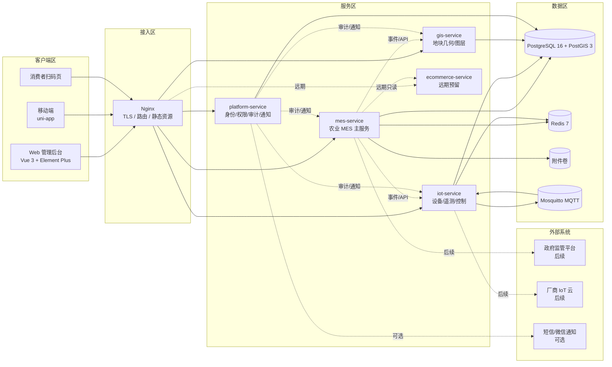

# 系统上下文与模块边界

- Change ID：N/A（项目级架构基线）
- 状态：DRAFT v1.0（2026-11-10 服务化架构修订；待基线审批）
- 来源基线：产品基线 v0.6-DRAFT、技术选型访谈（2026-11-10）、用户 2026-11-10 架构指令
- 关联需求/AC：FLOW-001~008、DO-001~028、BR-001~009
- 生成日期/版本：2026-11-10 / v1.0.0

## 1. 系统定位

本项目采用**服务化架构**，以一个农业 MES 主服务管理农业生产，IoT、GIS、电商与平台服务分别承担设备接入、地理信息、远期交易与身份审计职责。

| 服务 | 定位 | 一期状态 | 核心职责 |
|---|---|---|---|
| `mes-service` | 农业 MES 主服务 | 启用 | 生产计划、农事模板、任务派工与审核、作业记录、农资库存、批次质检与溯源、监管汇总 |
| `iot-service` | IoT 服务 | 启用 | 设备注册、遥测采集、阈值预警、远程控制、设备适配层与模拟器 |
| `gis-service` | GIS 服务 | 启用 | 地块几何、图层查询、GeoJSON/OGC 输出、空间索引 |
| `platform-service` | 平台服务 | 启用 | 用户、角色、权限、登录、审计日志、通知、系统配置 |
| `ecommerce-service` | 电商服务 | 远期预留，默认不部署 | 商品、订单、支付、售后；仅消费溯源只读数据 |

> 主服务定位为 **MES（制造执行系统）的农业版本**：田间、大棚、养殖场视为生产车间，管理“计划 → 工单/任务 → 物料消耗 → 作业记录 → 质量检测 → 批次追溯”全链路。设备遥测、地理几何、电商交易不属于 MES 主数据。

## 2. 系统上下文

## 3. 系统职责与非目标

### 3.1 系统职责

- `mes-service`：以 MES 方式管理农业生产，覆盖生产计划、农事模板、任务派工与审核、作业记录、农资库存、批次质检与溯源；监管汇总作为 MES 的只读报表模块。
- `iot-service`：设备注册、遥测采集、阈值预警、远程控制与设备适配；一期模拟数据，预留 MQTT/Modbus/厂商云 API。
- `gis-service`：地块几何、图层与空间查询；为 Web、移动端与监管看板提供地块地理信息展示。
- `platform-service`：统一身份、RBAC、审计、通知与系统配置；签发 JWT，其他服务本地校验并强制执行权限。
- `ecommerce-service`：远期电商能力预留；一期不部署、不落库、不开放 API；启动前必须完成产品基线修订（Q-004 范围重评）。

### 3.2 明确非目标

- 一期不接入真实传感器与控制器硬件；只做模拟数据与适配层。
- 一期不建设真实测绘底图与法定坐标；GIS 支持手工绘制/导入边界与 GeoJSON 展示，真实坐标待 Q-014 决策。
- 一期不实现电商交易；`ecommerce-service` 仅为远期边界与部署预留。
- 一期不引入 Kubernetes、消息中间件集群或多租户 SaaS 计费。
- 不在本阶段决定物理表结构、接口字段清单和页面组件树；这些由阶段 07 的 Change 设计细化。

## 4. 服务边界与依赖

| 服务 | 领域 | 拥有的数据 | 允许依赖 | 禁止行为 |
|---|---|---|---|---|
| `platform-service` | DOM-001 身份与权限、DOM-009 平台支撑 | DO-019、DO-020、DO-021、DO-026、DO-028 | 无业务服务 | 不拥有农场、生产、库存、批次、设备、GIS 几何数据 |
| `mes-service` | DOM-002 农场与基础数据、DOM-003 生产计划与任务、DOM-004 农事执行、DOM-005 农资与库存、DOM-007 批次与溯源、DOM-008 监管与报表 | DO-001~009、DO-015~018、DO-022~024、DO-027 | platform-service、iot-service、gis-service（只读/事件） | 不直接写设备遥测、GIS 几何、电商订单；不跨 schema 写 platform/iot/gis |
| `iot-service` | DOM-006 环境与设备 | DO-010~014 | platform-service | 不写农场主数据、生产计划、批次、库存；不直接写 MES schema |
| `gis-service` | DOM-010 GIS | ENT-029 地块几何（引用 DO-001） | platform-service、mes-service（地块主数据事件/API） | 不拥有 DO-001 业务地块；不写 MES 生产、批次、库存 |
| `ecommerce-service` | DOM-011 电商（远期） | 未来商品/订单/支付/售后（未分配 DO） | platform-service、mes-service（溯源只读） | 一期不部署、不落库、不开放 API；不写 MES 主数据 |

**服务间调用规则**：只允许通过 HTTPS API 或领域事件（Outbox）交互；禁止跨服务直接读写数据库 schema、共享表或内部实现。共享 PostgreSQL 实例只是部署便利，不构成跨服务数据所有权。

## 5. 信任区与边界

| 信任区 | 包含 | 信任级别 | 关键控制 |
|---|---|---|---|
| 客户端区 | Web 管理后台、uni-app 移动端、消费者扫码页 | 不可信 | 输入校验、JWT 鉴权、权限校验、限流、HTTPS |
| 接入区 | Nginx、TLS 终止、静态资源、服务路由 | 半可信 | TLS、请求体大小限制、安全响应头、访问日志、路径路由 |
| 服务区 | platform/mes/iot/gis/ecommerce 服务 | 可信 | 服务间 JWT、RBAC、审计、幂等、事务边界 |
| 数据区 | PostgreSQL + PostGIS、Redis、附件卷、MQTT | 高可信 | 内网隔离、schema 权限、备份、加密与保留策略 |
| 设备区 | 模拟设备、未来真实网关 | 半可信 | 设备身份、协议适配、数据校验、指令白名单 |

- 消费者扫码接口是唯一匿名只读入口，只返回批次公开信息。
- 政府监管账号为只读角色，数据范围受辖区限制；不得下发指令或修改业务数据。
- `ecommerce-service` 一期不对外暴露；Nginx 对 `/api/v1/ecommerce/**` 返回 404 或 503，直到产品基线修订与部署启用。
- 设备适配层只能通过 `iot-service` 受控接口进入系统，不直接访问 MES/GIS 数据库。

## 6. 外部系统与 SLA

| 外部系统 | 一期是否接入 | 交互方式 | SLA/约束 | 失败处理 |
|---|---|---|---|---|
| 真实 IoT 设备/网关 | 否 | 预留 MQTT、Modbus、厂商云 API 适配 | 后续按设备协议确定 | 适配层隔离，设备离线不阻断核心业务 |
| 政府监管平台 | 否 | 预留 HTTPS 数据交换或报表导出 | 后续按监管接口规范确定 | 导出/重试，数据缺失标注 |
| 短信/微信通知 | 可选 | 预留通知通道接口 | 按供应商 SLA | 站内通知为主，外部通道失败不回滚业务 |
| 对象存储/S3 | 否 | 一期本地附件卷，预留 S3 适配 | 后续按附件量确定 | 本地卷备份，失败重试 |
| 地图底图服务 | 可配置 | 前端底图可配置 OSM/天地图/高德等 | 按底图供应商许可与配额 | 底图不可用时仍展示 GeoJSON 地块层 |

## 7. 关键非功能约束

| NFR | 目标 | 架构响应 |
|---|---|---|
| NFR-001 性能 | 一期 <100 并发 | 单机 Docker Compose、服务隔离、连接池、Redis 缓存、分页查询 |
| NFR-002 安全 | RBAC、操作留痕 | platform-service JWT + RBAC、服务间 JWT、审计日志、最小权限 |
| NFR-003 数据保留 | 2 年 | PostgreSQL 分区/归档、备份保留 30 天、年度复核 |
| NFR-004 弱网/离线 | 田间弱网 | 移动端请求超时与重试、离线草稿仅本地暂存、提交幂等 |

## 8. 状态与审批

- 当前状态：DRAFT v1.0，等待产品/架构/技术负责人批准后冻结。
- 机器权威：`docs/architecture/baseline-manifest.json` 与 `constraint-registry.json`。
- 变更方式：冻结后只能通过基线修订流程修改，不得直接编辑本文件。
