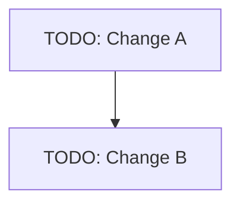

# Change 路线图

| Change ID | 目标/价值 | 范围/非目标 | 关联 FLOW/NODE/DO/BR | 预期验收方向 | 依赖 | 适用基线域/版本 | 复用约束/来源 ID | 潜在基线修订/BCR/ADR | 风险/迁移 | 优先级/排序理由 | 验收人/状态 |
|---|---|---|---|---|---|---|---|---|---|---|---|
| TODO-change-id | TODO | TODO | TODO | TODO | TODO | TODO | N/A / TODO | TODO | TODO | TODO | 待规划 |

> 本路线图只做候选 Change 的初步基线影响识别；提案级 UC/US/AC 在阶段 05 细化；每个实际 Change 仍必须在阶段 05 形成详细的 `design/baseline-impact.md`。
