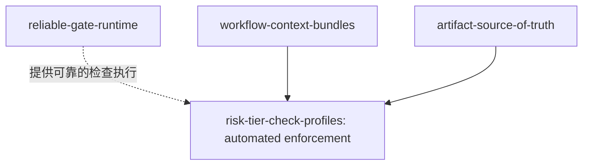

# Change 路线图

- Change ID：N/A（项目级路线图）
- 状态：READY_FOR_REVIEW（Stage 04 已按 BCR 重开）
- 来源基线：产品基线 v0.3.0、架构基线 v0.2.2
- 关联需求/AC：RA-001、NFR-001、FLOW-001、NODE-001-01–09、DO-001–005、RD-001–009、BR-001–007、Q-003、DEC-001–005；Change 级 AC 留待阶段 05 建立
- 生成日期/版本：2026-11-17 / v0.3.1-draft

## 1. 路线图总表

| Change ID | 目标/价值 | 范围 | 非目标 | FLOW/NODE/DO/BR | 预期验收方向 | 依赖 | 基线域/版本 | 复用约束 | 潜在基线修订/BCR/ADR | 风险/迁移 | 规模/分类 | 优先级/验收人 | 影响标签 |
|---|---|---|---|---|---|---|---|---|---|---|---|---|---|
| reliable-gate-runtime | 让阶段检查与审批在 Windows 和 Unix 环境中都能可靠执行，减少 AI coding 交接中断。 | Windows 下识别真正可启动的 Bash；按 DEC-001 将包结构检查与回归测试分开；让已记录的用户审批可被 transition 使用，不再要求手工改阶段证据；改善失败提示。 | 不改变审批人、审批边界、必需证据或强制检查；不自动安装依赖或部署 CI。 | FLOW-001；NODE-001-04–06；DO-004/005；BR-005–007 | Windows 和 Unix 上，包检查要么用实际可启动的 Shell 执行语法检查，要么明确说明如何配置；回归测试只通过显式测试命令运行；用户执行 approve 后，transition 可使用对应审批记录并生成有效交接，无需手工同步证据状态；缺少或不匹配审批时仍阻断。 | 无 | architecture、api、test_quality；v0.2.2 | ARCH-BOUNDARY-001、ARCH-STATE-001、API-CLI-001、QUALITY-EVIDENCE-001、LEGACY-TOOLKIT-001/002 | 若保持已批准的门禁语义则 CHANGE_ONLY；若改变审批语义或必需证据，重新评估并提交基线变更。 | 跨环境可执行文件探测；回归检查必须使用隔离状态；保留 CLI 退出码语义。 | 小；TOOLING/WORKFLOW/QUALITY；CHANGE_ONLY | P0；用户/项目负责人，技术复核 | TOOLING、WORKFLOW、QUALITY、WINDOWS |
| workflow-context-bundles | 为 coding Agent 提供可直接使用且可计量的上下文包，让它只读取相关输入，并验证 8 组/12,000 字符目标。 | 使用阶段配置和 Change 影响标签选取必需及条件输入；生成实际包含的文本/章节；报告展开后的字符数、来源、命中标签及条件文件读取原因；输出精简任务卡，包含目标、约束、路径和检查项。 | 不削弱审批、基线、追踪、独立验证或硬质量门禁；不把完整基线复制到新的常驻摘要；不绑定特定模型或 Agent 厂商。 | FLOW-001；NODE-001-01–04；DO-001–003；BR-001/003/004；NFR-001；DEC-002/004 | 每个阶段/Change 可生成可复现的清单与上下文包；默认读取组数不超过 8，实际展开字符数不超过 12,000；只有命中标签/触发条件的条件资料才加入；超限时指出最大上下文来源并要求缩小范围或记录有据的例外。 | 无；可与 `artifact-source-of-truth`、`reliable-gate-runtime` 并行 | product、architecture；v0.2.0 / v0.2.2 | PRODUCT-CONTEXT-001、ARCH-BOUNDARY-001、DATA-OWNERSHIP-001、LEGACY-TOOLKIT-002、QUALITY-EVIDENCE-001 | 在落实已批准的 12,000 字符目标和现有标签规则时为 CHANGE_ONLY；若改变默认预算或适用范围，需重新评审基线。 | 需对换行和编码定义确定性计数；生成包默认临时呈现或标注为派生物，避免引入第二事实源。 | 中；CONTEXT/TOOLING；CHANGE_ONLY | P0；用户/项目负责人 | CONTEXT、REQUIREMENTS、ARCHITECTURE、TOOLING |
| artifact-source-of-truth | 减少重复事实与维护漂移，同时保留审计和追踪证据。 | 将 `STEP-ARTIFACT-CONTRACTS.json` 明确为阶段 I/O 权威契约；可行时由它生成阶段 I/O 表和交叉引用摘要；区分必需证据与摘要；增加派生文件新鲜度检查并指回来源 ID/路径。 | 不删除必需评审、测试、追踪或审批证据；不改变阶段边界；不静默改写冻结基线规则。 | FLOW-001；NODE-001-02–06；DO-002–005；BR-002/005/007；DEC-004 | 每个派生视图标注来源且可重复生成；新鲜度检查通过；每项必需输出都有消费者或明确标为仅证据；规范需求和门禁不只存在于生成摘要中。 | 无；可与 `workflow-context-bundles`、`reliable-gate-runtime` 并行 | architecture、data_domain、test_quality；v0.2.2 | ARCH-BOUNDARY-001、DATA-OWNERSHIP-001、ARCH-STATE-001、QUALITY-EVIDENCE-001、LEGACY-TOOLKIT-002 | 若 JSON 契约保持权威且规范不变则 CHANGE_ONLY；若改变所有权、审批或证据语义，需 BCR/ADR。 | 现有 Markdown/CSV 可能被外部消费；保留路径或设置迁移兼容期，并审查生成差异。 | 中；GOVERNANCE/DOCS/TOOLING；CHANGE_ONLY | P1；用户/项目负责人，技术复核 | GOVERNANCE、DOCS、TOOLING、TRACEABILITY |
| risk-tier-check-profiles | 将已批准的 Q-003 风险规则映射为可执行检查配置，并为每次 Change 生成可审计的分类和检查记录。规则定义及基线批准已由 `BCR-Q003-RISK-TIER-POLICY` 完成；本 Change 不重新定义风险政策。 | 按冻结业务规则中的可逆性、安全/隐私/权限、数据迁移、外部边界、冻结基线影响、UI、工作流和代码影响信号计算档位；将影响标签/档位映射到命令及证据；记录命中信号、执行/跳过项及理由；缺少证据时失败关闭。 | 任何档位都不能豁免用户审批、状态完整性、必需基线审批、安全/权限检查或政策要求的独立验证。 | FLOW-001；NODE-001-02/04–07/09；DO-002–005；BR-003/006/007；Q-003；DEC-003/005 | 相同输入得到与冻结规则一致的档位；每档执行定义的检查并保存命令/退出码/证据；只有规则允许的检查可跳过且必须说明理由；发现更高风险信号时升级；低风险配置不能绕过硬门禁。 | 依赖 `workflow-context-bundles` 和 `artifact-source-of-truth` 提供标签和权威检查目录；启用自动执行前应完成 `reliable-gate-runtime` | product、architecture、test_quality；v0.3.0 / v0.2.2 | PRODUCT-CONTEXT-001、ARCH-STATE-001、DATA-OWNERSHIP-001、QUALITY-EVIDENCE-001、LEGACY-TOOLKIT-002；对应标签命中时适用 EXT-GITHUB-001/EXT-FIGMA-001/EXT-WEB-001 | CHANGE_ONLY：遵守已批准 BCR 与冻结矩阵；若实现发现规则缺口，先提交后续 BCR，不得自行改政策。 | 错误映射可能跳过必要检查；按业务规则最高命中判级；不确定时升档；安全、数据、外部接口、基线和工作流门禁不可跳过。 | 中；QUALITY/GOVERNANCE；CHANGE_ONLY | P1，依赖完成后；技术/质量负责人及用户/项目负责人 | RISK、QUALITY、SECURITY、DATA、THIRD_PARTY、BASELINE、EXISTING_CODE |

## 2. 依赖图

Q-003 policy definition is a baseline decision, approved separately through `BCR-Q003-RISK-TIER-POLICY`; it is no longer a prerequisite produced by the automation Change. The dependencies below apply to implementing/activating the automated selector only.

前三项是互相独立的纵向切片，路线图获批后可并行规划。风险分级检查依赖先明确上下文标签和权威检查目录，避免再建立第二份标签/检查注册表。

## 3. 排序依据与并行机会

1. **P0 — `workflow-context-bundles`**：最直接回应用户目标。当前阶段 04 上下文已占满 8/8 读取组，但生成器没有报告展开后的字符数，因此尚无证据证明达到 12,000 字符目标。
2. **P0 — `reliable-gate-runtime`**：处理已观察到的执行摩擦：WindowsApps 提供的 Bash 别名无法启动；审批命令记录的用户批准与阶段证据中的待审批状态需衔接；包检查还包含回归测试调用，与 DEC-001 不一致。这些问题影响复现和交接可靠性。
3. **P1 — `artifact-source-of-truth`**：落实已批准的“一事实一权威源”，减少契约、摘要和生成视图之间重复维护。可与前两项并行。
4. **P1 — `risk-tier-check-profiles`**：在 Q-003 基线矩阵已冻结后，将它自动化；实现依赖上下文标签和权威检查目录，并在 `reliable-gate-runtime` 完成后启用自动调度。共享规则的任何变更仍须另行批准基线修订。

路线图保留当前所有安全门禁。低风险配置只能省略已证明与本 Change 无关的检查，不能取消审批、证据完整性、基线治理或必需的独立审查。

## 4. 各 Change 的边界与完成定义

- **`workflow-context-bundles`**：一个命令生成精确计量的 Agent 输入和任务卡；清单记录每个来源、选中章节、触发条件和字符贡献。默认不生成长期重复摘要。
- **`artifact-source-of-truth`**：单一权威契约源驱动声明的摘要；生成结果可重现且有检查模式并回指源记录。正式证据与派生文档分开管理。
- **`reliable-gate-runtime`**：现有命令在支持的平台上可执行或能明确失败；检查职责继续显式分离；真实审批记录足以让状态迁移继续，缺失/不匹配审批仍被阻断。
- **`risk-tier-check-profiles`**：批准后的判级规则和命令配置可执行；每次运行记录风险档位、命中标签、执行/跳过的检查、理由和证据；不确定时升级而不是降低检查。

每个 Change 必须符合切片规则：一个独立验收能力、关键 AC 不超过 12 条、跨域依赖不超过 2 项。超出时须在阶段 05 前继续拆分。

## 5. 远期能力（不进入一期路线图）

- N/A：不包含农业业务应用、Web 界面、数据库、设备集成或生产 CI 推广。当前批准范围是本地 AI coding 流程工具包；扩展范围须重新进行范围和架构评审。

## 6. 未决问题、风险与审批

| 项目 | 状态 | 负责人 | 处理方式 |
|---|---|---|---|
| Q-003：低/标准/高风险的具体标准和检查集合 | CLOSED by BCR-Q003-RISK-TIER-POLICY; matrix is in the frozen product/test-quality baseline | 用户/技术质量负责人 | 自动选档器由 `risk-tier-check-profiles` 实现；如政策需改变，另开基线修订。 |
| 真实 Change 中的 12,000 字符预算 | 待验证 | 流程负责人/用户 | 先计量实际渲染内容，再用首个有代表性的 Change 复核目标；不得静默提高已批准的目标值。 |
| 审批证据交接行为 | 待复核的缺陷 | 技术负责人 | 在 `reliable-gate-runtime` 中建立隔离验收场景；保留显式用户审批和只能通过状态机迁移的规则。 |
| 路线图顺序及首个 Change | 待用户/产品负责人批准 | 用户/项目负责人 | 评审本路线图；批准排序和首项 Change 后才创建 OpenSpec Change。 |

本路线图仅为提案。阶段 04 交接获明确批准后才可进入阶段 05；路线图获批后再逐项创建 OpenSpec Change。
