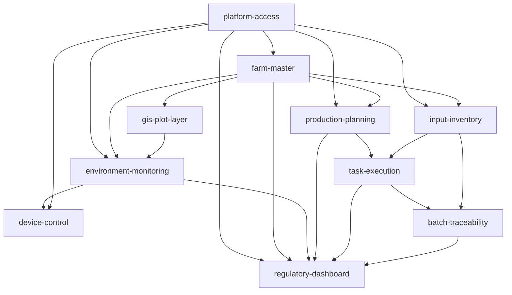

# Change 路线图

- Change ID：N/A（项目级路线图）
- 状态：DRAFT v1.0（阶段 04 提案拆分；待产品与技术负责人批准）
- 来源基线：项目基线 v1.0.0（FROZEN 2026-11-10）、产品基线 v0.6、阶段 03 基线审计报告
- 关联需求/AC：FLOW-001~008、NODE-001-01~NODE-008-12、DO-001~028、BR-001~009
- 生成日期/版本：2026-11-10 / v1.0

## 1. 路线图总表

| Change ID | 目标/价值 | 范围 | 非目标 | 关联 FLOW/NODE/DO/BR | 预期验收方向 | 依赖 | 基线域/版本 | 复用约束 | 潜在基线修订/BCR/ADR | 风险/迁移 | 规模/分类 | 优先级/验收人 |
|---|---|---|---|---|---|---|---|---|---|---|---|---|
| platform-access | 建立登录、RBAC、数据范围、审计与通知基础，解锁全部业务 Change | 用户、角色、权限、登录与 JWT、数据范围、审计日志、站内通知、系统配置基础 | 不涉及农场、生产、库存、批次、设备、GIS 业务数据；不做外部 IdP/SSO | FLOW-008 NODE-008-01~12；DO-019/020/021/026/028；BR-003/BR-005/BR-006 | 登录成功/失败/停用；角色与数据范围；越权拒绝并审计；审计追加不可删；通知可达；配置留痕 | 无（路线图起点） | 产品/架构/数据/API/前端/测试 v1.0.0 FROZEN | API-AUTH-001；API-ERROR-001；API-IDEMP-001；FE-REQUEST-001；FE-PERM-001；QUALITY-TEST-001；QUALITY-AC-001；SERVICE-BOUNDARY-001；DATA-AUDIT-001；DEPLOY-TECH-001 | 无基线修订；具体 operationId 属 Change；分类 CHANGE_ONLY | JWT 撤销与短 TTL；角色模型；绿地为空无数据迁移 | 1 能力；3 角色；0 依赖；0 新增跨功能公共契约；预算内；CHANGE_ONLY | P0 第 1；产品/技术负责人 |
| farm-master | 建立农场、地块、品种、作业类型主数据，为生产、环境、库存、溯源提供稳定引用 | 农场/园区、地块、品种、作业类型 CRUD；数据范围；引用校验 | 不含 GIS 几何（另立 gis-plot-layer）；不含计划/任务/设备 | FLOW-004 NODE-004-01；DO-001/002/023/024；BR-005/BR-008 | 主数据唯一与引用完整；数据范围；停用不影响历史；下游可引用 | platform-access | 产品/架构/数据/API/前端/测试 v1.0.0 FROZEN | DATA-OWNERSHIP-001；SERVICE-BOUNDARY-001；API-AUTH-001；API-ERROR-001；FE-PERM-001 | 无基线修订；分类 CHANGE_ONLY | 主数据字段膨胀；无历史数据迁移 | 1 能力；2 角色；1 依赖；预算内；CHANGE_ONLY | P0 第 2；产品/技术负责人 |
| gis-plot-layer | 增加 GIS 服务，展示地块边界、状态、任务与预警的地理信息 | PostGIS schema、地块几何录入/导入 GeoJSON、图层查询 API、Web/H5 地图组件、点选地块 | 不含真实测绘坐标与法定底图（Q-014）；不含空间分析、路径规划、3D | FLOW-004 NODE-004-01；FLOW-001 NODE-001-05；DO-001；ENT-029；BR-005 | 几何录入/导入校验；GeoJSON 图层；地图加载/空态/错误/权限；点选地块；要素上限 | platform-access；farm-master | 产品/架构/数据/API/前端/测试 v1.0.0 FROZEN | GIS-GEOMETRY-001；SERVICE-BOUNDARY-001；API-AUTH-001；FE-REQUEST-001；FE-PERM-001 | 无基线修订；分类 CHANGE_ONLY；Q-014 决策后可能追加 GIS 数据策略 | PostGIS 性能；uni-app 小程序地图差异；Q-014；几何导入校验 | 1 能力；2 角色；2 依赖；预算内；CHANGE_ONLY | P1；farm-master 后，可与 environment-monitoring 并行 |
| environment-monitoring | 实时环境监测与阈值预警，支撑农事决策 | 设备注册、模拟遥测接入、阈值配置、预警生成与处理、监测视图、离线/非法数据 | 不含真实硬件协议；不含远程控制（另立 device-control）；不含 GIS 空间分析 | FLOW-001 NODE-001-01~09；DO-010/011/012/013/026；BR-004 | 遥测入库；非法拒绝；超限预警；离线通知；阈值版本；监测视图 | platform-access；farm-master；gis-plot-layer | 产品/架构/数据/API/前端/测试 v1.0.0 FROZEN | IOT-OWNERSHIP-001；SERVICE-BOUNDARY-001；API-AUTH-001；API-ERROR-001；QUALITY-TEST-001 | 无基线修订；分类 CHANGE_ONLY | 模拟与真实设备差异；遥测量；离线/非法分支；GIS 可选降级 | 1 能力；3 角色；3 直接依赖；超建议上限，理由：监测页需要地块图层；验收人产品/技术；CHANGE_ONLY | P1；farm-master 与 gis-plot-layer 后 |
| device-control | 在授权范围内远程控制灌溉、照明、通风等设备，指令可审计 | 设备控制 UI/API、权限与归属校验、指令下发/回执、失败补偿、指令历史 | 不含自动规则/场景联动；不含真实协议对接；不含批量控制 | FLOW-005 NODE-005-01~08；DO-010/014/021；BR-003/BR-005 | 越权拒绝；离线提示；指令记录；失败补偿；历史查询 | environment-monitoring；platform-access | 产品/架构/数据/API/前端/测试 v1.0.0 FROZEN | IOT-OWNERSHIP-001；DATA-AUDIT-001；API-IDEMP-001；SERVICE-BOUNDARY-001；API-AUTH-001 | 无基线修订；分类 CHANGE_ONLY | 非幂等指令；超时补偿；审计完整性 | 1 能力；2 角色；2 依赖；预算内；CHANGE_ONLY | P1；environment-monitoring 后 |
| input-inventory | 农资采购入库、领用出库、库存台账与安全库存预警 | 农资/供应商档案、入库验收、出库/领用、库存扣减、盘点、安全库存 | 不含采购审批/财务付款；不含供应商门户；不含批次成本核算 | FLOW-006 NODE-006-01~09；DO-007/008/009/025；BR-007 | 入库/出库幂等；负库存拦截；库存台账；安全库存预警；验收不合格退回 | platform-access；farm-master | 产品/架构/数据/API/前端/测试 v1.0.0 FROZEN | DATA-INVENTORY-001；DATA-OWNERSHIP-001；API-IDEMP-001；SERVICE-BOUNDARY-001 | 无基线修订；分类 CHANGE_ONLY | 并发扣减；幂等；库存调整审计 | 1 能力；3 角色；2 依赖；预算内；CHANGE_ONLY | P0；farm-master 后，可与 production-planning 并行 |
| production-planning | 生产计划、农事模板、任务生成、派工与审核 | 生产计划、农事模板、任务生成、派工、审核、驳回/重派、逾期提醒 | 不含任务执行/记录（另立 task-execution）；不含物料定额自动计算（远期）；不含排程优化 | FLOW-004 NODE-004-01~04/06/07/08/09~12；DO-003/004/005/019/026；BR-008/BR-009 | 计划生成；模板任务；派工；审核/驳回；冲突/模板缺失/逾期 | platform-access；farm-master | 产品/架构/数据/API/前端/测试 v1.0.0 FROZEN | DATA-TASK-001；API-IDEMP-001；SERVICE-BOUNDARY-001；DATA-OWNERSHIP-001 | 无基线修订；分类 CHANGE_ONLY | 模板建模；任务状态机；计划冲突 | 1 能力；2 角色；2 依赖；预算内；CHANGE_ONLY | P0；farm-master 后，可与 input-inventory 并行 |
| task-execution | 任务执行、作业记录、农资消耗与提交审核 | 任务执行、作业记录字段/照片、农资扣减调用、补录、提交待审核、越权/库存不足 | 不含任务生成/审核（production-planning）；不含批次/溯源（batch-traceability）；不含完整离线模式 | FLOW-002 NODE-002-01~10；NODE-004-05；DO-005/006/007/008/009；BR-007/BR-008/BR-009 | 记录完整；农资扣减一致；库存不足 409；提交待审核；补录可区分；越权审计 | production-planning；input-inventory | 产品/架构/数据/API/前端/测试 v1.0.0 FROZEN | DATA-INVENTORY-001；DATA-TASK-001；API-IDEMP-001；SERVICE-BOUNDARY-001；QUALITY-TEST-001 | 无基线修订；分类 CHANGE_ONLY | 跨域事务；弱网；照片/附件；重复提交 | 1 能力；2 角色；2 直接依赖；platform/farm 为已冻结的传递依赖；预算内；CHANGE_ONLY | P0；两者完成后 |
| batch-traceability | 生产批次、检测报告、溯源码与消费者扫码 | 批次形成、检测报告上传/校验、溯源码生成/打印、消费者扫码页、缺失数据提示 | 不含电商/物流/包装；不含多级追溯；不含监管平台对接 | FLOW-003 NODE-003-01~10；DO-015/016/017/018；BR-001/BR-002/BR-009 | 批次关联；报告前置；一码唯一；扫码公开字段；缺失提示；重复码拒绝 | task-execution；input-inventory | 产品/架构/数据/API/前端/测试 v1.0.0 FROZEN | DATA-BATCH-001；DATA-TRACE-001；DATA-REPORT-001；API-IDEMP-001；API-AUTH-001；DATA-OWNERSHIP-001 | 无基线修订；分类 CHANGE_ONLY | 码唯一；公开数据隐私；附件；报告校验 | 1 能力；2 角色；2 依赖；预算内；CHANGE_ONLY | P0；task-execution 后 |
| regulatory-dashboard | 政府监管端辖区汇总、只读下钻与导出 | 辖区与监管账号、汇总视图、下钻、导出、缺失数据标注 | 不含监管写操作；不含实时流；不含外部政府平台；不含跨辖区分析 | FLOW-007 NODE-007-01~08；DO-022/023/027/001/011/005/015；BR-005 | 辖区隔离；汇总口径；下钻；导出；缺失不默认为零；越权审计 | platform-access；farm-master；environment-monitoring；production-planning；task-execution；batch-traceability | 产品/架构/数据/API/前端/测试 v1.0.0 FROZEN | SERVICE-BOUNDARY-001；API-AUTH-001；FE-PERM-001；DATA-OWNERSHIP-001 | 无基线修订；分类 CHANGE_ONLY | 五域只读聚合；汇总性能；数据缺失；导出权限 | 1 能力；2 角色；6 直接依赖；超预算，理由：监管看板必须聚合环境/计划/执行/批次/溯源；验收人产品/技术；CHANGE_ONLY | P2；所有上游后 |

## 2. 依赖图

无循环依赖；依赖图只表达直接依赖，platform-access 与 farm-master 作为基础能力为后续 Change 提供传递支撑。

## 3. 排序依据与并行机会

- **P0 主链路**：`platform-access` → `farm-master` → `production-planning` 与 `input-inventory` → `task-execution` → `batch-traceability`。这条链路覆盖“登录与权限 → 农场/地块 → 计划/任务 → 作业记录/农资消耗 → 批次/质检/溯源”，是农业 MES 的核心价值，应优先纵向打通。
- **P1 支撑能力**：`gis-plot-layer`、`environment-monitoring`、`device-control`。GIS 与监测可在 `farm-master` 后并行；设备控制依赖设备注册与遥测，放在监测之后。
- **P2 监管汇总**：`regulatory-dashboard` 依赖环境、计划、执行、批次/溯源四类数据，放在主链路与支撑能力之后，避免过早建设空看板。
- **并行机会**：`gis-plot-layer` 与 `environment-monitoring` 可由两条并行工作线推进；`production-planning` 与 `input-inventory` 也可并行，汇合点是 `task-execution`。
- **首个 Change**：`platform-access`。理由是零业务依赖、解锁全部后续 Change，且能尽早验证 JWT/RBAC/审计与多服务鉴权。

## 4. 每个 Change 的边界说明

### platform-access

- 价值：建立统一登录、RBAC、数据范围与审计基础，避免各 Change 自行实现权限。
- 范围：用户/角色/权限、登录与 JWT、数据范围、审计日志、站内通知、系统配置基础。
- 非目标：不涉及农场、生产、库存、批次、设备、GIS 业务数据；不做外部 IdP/SSO。
- 依赖/解锁：无直接依赖；解锁全部业务 Change。
- 验收锚点：登录成功/失败/停用；角色与数据范围；越权拒绝并审计；审计追加不可删；通知可达；配置留痕。
- 规模预算：1 能力、3 角色、0 依赖、0 新增跨功能公共契约；预算内。
- 基线/约束：产品、架构、数据、API、前端、测试 v1.0.0 FROZEN；API-AUTH-001、API-ERROR-001、API-IDEMP-001、FE-REQUEST-001、FE-PERM-001、QUALITY-TEST-001、QUALITY-AC-001、SERVICE-BOUNDARY-001、DATA-AUDIT-001、DEPLOY-TECH-001。
- 风险：JWT 撤销与短 TTL；角色模型；绿地为空无数据迁移。

### farm-master

- 价值：建立农场、地块、品种、作业类型主数据，为生产、环境、库存、溯源提供稳定引用。
- 范围：农场/园区、地块、品种、作业类型 CRUD；数据范围；引用校验。
- 非目标：不含 GIS 几何（另立 gis-plot-layer）；不含计划/任务/设备。
- 依赖/解锁：依赖 platform-access；解锁 gis-plot-layer、environment-monitoring、input-inventory、production-planning。
- 验收锚点：主数据唯一与引用完整；数据范围；停用不影响历史；下游可引用。
- 规模预算：1 能力、2 角色、1 依赖；预算内。
- 基线/约束：v1.0.0 FROZEN；DATA-OWNERSHIP-001、SERVICE-BOUNDARY-001、API-AUTH-001、API-ERROR-001、FE-PERM-001。
- 风险：主数据字段膨胀；无历史数据迁移。

### gis-plot-layer

- 价值：增加 GIS 服务，展示地块边界、状态、任务与预警的地理信息。
- 范围：PostGIS schema、地块几何录入/导入 GeoJSON、图层查询 API、Web/H5 地图组件、点选地块。
- 非目标：不含真实测绘坐标与法定底图（Q-014）；不含空间分析、路径规划、3D。
- 依赖/解锁：依赖 platform-access、farm-master；解锁 environment-monitoring 的地图展示与 regulatory-dashboard 的地块下钻。
- 验收锚点：几何录入/导入校验；GeoJSON 图层；地图加载/空态/错误/权限；点选地块；要素上限。
- 规模预算：1 能力、2 角色、2 依赖；预算内。
- 基线/约束：v1.0.0 FROZEN；GIS-GEOMETRY-001、SERVICE-BOUNDARY-001、API-AUTH-001、FE-REQUEST-001、FE-PERM-001。
- 风险：PostGIS 性能；uni-app 小程序地图差异；Q-014；几何导入校验。

### environment-monitoring

- 价值：实时环境监测与阈值预警，支撑农事决策。
- 范围：设备注册、模拟遥测接入、阈值配置、预警生成与处理、监测视图、离线/非法数据。
- 非目标：不含真实硬件协议；不含远程控制（另立 device-control）；不含 GIS 空间分析。
- 依赖/解锁：依赖 platform-access、farm-master、gis-plot-layer；解锁 device-control 与 regulatory-dashboard。
- 验收锚点：遥测入库；非法拒绝；超限预警；离线通知；阈值版本；监测视图。
- 规模预算：1 能力、3 角色、3 直接依赖；超建议上限，理由：监测页需要地块图层；验收人产品/技术。
- 基线/约束：v1.0.0 FROZEN；IOT-OWNERSHIP-001、SERVICE-BOUNDARY-001、API-AUTH-001、API-ERROR-001、QUALITY-TEST-001。
- 风险：模拟与真实设备差异；遥测量；离线/非法分支；GIS 可选降级。

### device-control

- 价值：在授权范围内远程控制设备，指令可审计。
- 范围：设备控制 UI/API、权限与归属校验、指令下发/回执、失败补偿、指令历史。
- 非目标：不含自动规则/场景联动；不含真实协议对接；不含批量控制。
- 依赖/解锁：依赖 environment-monitoring、platform-access；解锁后续设备联动能力（不在本路线图）。
- 验收锚点：越权拒绝；离线提示；指令记录；失败补偿；历史查询。
- 规模预算：1 能力、2 角色、2 依赖；预算内。
- 基线/约束：v1.0.0 FROZEN；IOT-OWNERSHIP-001、DATA-AUDIT-001、API-IDEMP-001、SERVICE-BOUNDARY-001、API-AUTH-001。
- 风险：非幂等指令；超时补偿；审计完整性。

### input-inventory

- 价值：农资采购入库、领用出库、库存台账与安全库存预警。
- 范围：农资/供应商档案、入库验收、出库/领用、库存扣减、盘点、安全库存。
- 非目标：不含采购审批/财务付款；不含供应商门户；不含批次成本核算。
- 依赖/解锁：依赖 platform-access、farm-master；解锁 task-execution 的农资消耗与 batch-traceability 的投入品关联。
- 验收锚点：入库/出库幂等；负库存拦截；库存台账；安全库存预警；验收不合格退回。
- 规模预算：1 能力、3 角色、2 依赖；预算内。
- 基线/约束：v1.0.0 FROZEN；DATA-INVENTORY-001、DATA-OWNERSHIP-001、API-IDEMP-001、SERVICE-BOUNDARY-001。
- 风险：并发扣减；幂等；库存调整审计。

### production-planning

- 价值：生产计划、农事模板、任务生成、派工与审核。
- 范围：生产计划、农事模板、任务生成、派工、审核、驳回/重派、逾期提醒。
- 非目标：不含任务执行/记录（另立 task-execution）；不含物料定额自动计算（远期）；不含排程优化。
- 依赖/解锁：依赖 platform-access、farm-master；解锁 task-execution 与 regulatory-dashboard。
- 验收锚点：计划生成；模板任务；派工；审核/驳回；冲突/模板缺失/逾期。
- 规模预算：1 能力、2 角色、2 依赖；预算内。
- 基线/约束：v1.0.0 FROZEN；DATA-TASK-001、API-IDEMP-001、SERVICE-BOUNDARY-001、DATA-OWNERSHIP-001。
- 风险：模板建模；任务状态机；计划冲突。

### task-execution

- 价值：任务执行、作业记录、农资消耗与提交审核。
- 范围：任务执行、作业记录字段/照片、农资扣减调用、补录、提交待审核、越权/库存不足。
- 非目标：不含任务生成/审核（production-planning）；不含批次/溯源（batch-traceability）；不含完整离线模式。
- 依赖/解锁：依赖 production-planning、input-inventory；解锁 batch-traceability。
- 验收锚点：记录完整；农资扣减一致；库存不足 409；提交待审核；补录可区分；越权审计。
- 规模预算：1 能力、2 角色、2 直接依赖；platform/farm 为已冻结的传递依赖；预算内。
- 基线/约束：v1.0.0 FROZEN；DATA-INVENTORY-001、DATA-TASK-001、API-IDEMP-001、SERVICE-BOUNDARY-001、QUALITY-TEST-001。
- 风险：跨域事务；弱网；照片/附件；重复提交。

### batch-traceability

- 价值：生产批次、检测报告、溯源码与消费者扫码。
- 范围：批次形成、检测报告上传/校验、溯源码生成/打印、消费者扫码页、缺失数据提示。
- 非目标：不含电商/物流/包装；不含多级追溯；不含监管平台对接。
- 依赖/解锁：依赖 task-execution、input-inventory；解锁 regulatory-dashboard 的批次/溯源汇总与远期电商溯源只读。
- 验收锚点：批次关联；报告前置；一码唯一；扫码公开字段；缺失提示；重复码拒绝。
- 规模预算：1 能力、2 角色、2 依赖；预算内。
- 基线/约束：v1.0.0 FROZEN；DATA-BATCH-001、DATA-TRACE-001、DATA-REPORT-001、API-IDEMP-001、API-AUTH-001、DATA-OWNERSHIP-001。
- 风险：码唯一；公开数据隐私；附件；报告校验。

### regulatory-dashboard

- 价值：政府监管端辖区汇总、只读下钻与导出。
- 范围：辖区与监管账号、汇总视图、下钻、导出、缺失数据标注。
- 非目标：不含监管写操作；不含实时流；不含外部政府平台；不含跨辖区分析。
- 依赖/解锁：依赖 platform-access、farm-master、environment-monitoring、production-planning、task-execution、batch-traceability；作为一期监管能力终点。
- 验收锚点：辖区隔离；汇总口径；下钻；导出；缺失不默认为零；越权审计。
- 规模预算：1 能力、2 角色、6 直接依赖；超预算，理由：监管看板必须聚合环境、计划、执行、批次与溯源；验收人产品/技术。
- 基线/约束：v1.0.0 FROZEN；SERVICE-BOUNDARY-001、API-AUTH-001、FE-PERM-001、DATA-OWNERSHIP-001。
- 风险：五域只读聚合；汇总性能；数据缺失；导出权限。

## 5. 远期能力（不进入一期路线图）

- `ecommerce-service`：商品、订单、支付、售后；默认不部署、不落库、不开放 API。启用前必须完成产品基线修订（Q-004 范围重评）与支付/隐私合规评估。分类为 `BASELINE_CHANGE_REQUIRED`，不是本路线图的候选 Change。
- 真实 IoT 硬件与 MQTT/Modbus 适配：在一期模拟数据验证后，按设备协议与厂商接入单独立项。
- 真实 GIS 测绘坐标、法定底图与高级空间分析：由 Q-014 决策后单独评估；一期只做手工/导入 GeoJSON 与示意展示。
- 政府监管平台外部对接：一期只做辖区汇总与导出，外部接口按监管规范另行立项。

## 6. 未决问题、风险与审批

- **Q-017 成功指标**：产品负责人尚未定义；当前排序以“农业生产管理主线 + 可追溯”作为优先级依据。成功指标确认后可能需要调整 P1/P2 顺序。负责人：用户；截止：路线图批准前或阶段 04 结束前。
- **Q-014 GIS 坐标与底图**：非阻断；`gis-plot-layer` 一期只承诺手工/导入 GeoJSON 与示意精度；真实测绘在 Q-014 决策后另行评估。负责人：用户/技术负责人。
- **Q-005 目标端**：移动端 H5 优先；小程序/App 影响 `gis-plot-layer` 与移动端 E2E，阶段 06 前确认。负责人：用户。
- **Q-015/Q-016 原型缺口**：影响页面清单与异常态设计，阶段 06 前处理；不阻塞本路线图。
- **TECH-RISK-001**：Spring Boot 4 + MyBatis/Spring Security 兼容性；所有 Change 共享风险，阶段 08 首个任务前验证，不兼容时回退 Spring Boot 3.5 LTS 并走基线修订。负责人：技术负责人。
- **基线冲突**：本路线图所有候选 Change 均为 `CHANGE_ONLY`；未发现需要提前修改冻结基线的候选。若实施中发现服务边界、数据所有权或公共契约冲突，暂停该 Change 并走 BCR/ADR，不得直接改冻结基线。
- **审批点**：产品负责人批准路线图与优先级；技术负责人确认依赖、基线影响与首个 Change `platform-access`；审批通过后才运行 `openspec new change platform-access`。
